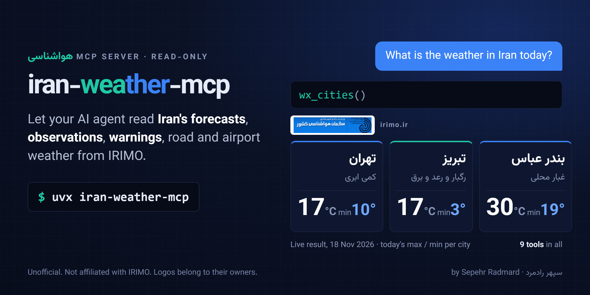

<!-- mcp-name: io.github.sepehr071/iran-weather-mcp -->

<div align="center">



# iran-weather-mcp: Iran Meteorological Organization (سازمان هواشناسی کشور) weather MCP server for AI agents

**iran-weather-mcp is an unofficial, read-only MCP server that lets an AI agent read forecasts, current observations and official weather warnings from the Iran Meteorological Organization (IRIMO, سازمان هواشناسی کشور, irimo.ir).**<br>
Its 9 tools list today's forecast for the main cities, show one city's current weather and 3-day forecast, list every station of a province, read the national station map, list and read official warnings (weather, marine, pollution, agriculture), show road weather along a main road, show airport TAF forecasts and link the latest PDF bulletins.<br>
No API key or account is needed; it works in Claude, Cursor, Copilot and any other MCP client. IRIMO answers only Iranian IPs, so the server uses the direct line by default.

[](https://pypi.org/project/iran-weather-mcp/)
[](https://pypi.org/project/iran-weather-mcp/)
[](https://github.com/sepehr071/iran-weather-mcp/actions/workflows/ci.yml)
[](https://github.com/sepehr071/iran-weather-mcp/blob/main/LICENSE)

[For AI agents](#for-ai-agents) · [Quick start](#quick-start) · [Tools](#tools) · [Limits](#limits) · [فارسی](#فارسی)

</div>

---

## For AI agents

- **What:** unofficial MCP server (model context protocol) for irimo.ir: main-city forecasts, current observations, 3-day city forecasts, province stations, official warnings, road weather, airport TAF forecasts and bulletin links.
- **Install:** `uvx iran-weather-mcp` or `claude mcp add iran-weather -- uvx iran-weather-mcp`. Transport: stdio. Needs [uv](https://docs.astral.sh/uv/getting-started/installation/) (Python 3.10+).
- **Auth:** none. Optional `IRAN_WEATHER_MCP_PROXY` (HTTP proxy URL, or a comma-separated list); system proxy settings are ignored.
- **Access:** read-only. It cannot log in or subscribe to anything. The site answers only Iranian IPs: from abroad set `IRAN_WEATHER_MCP_PROXY` to an Iranian proxy.
- **Tools:** 9, all prefixed `wx_`. Typical sequences: `wx_cities` -> `wx_weather`; `wx_weather` -> `wx_province`; `wx_warnings` -> `wx_warning`; `wx_road` and `wx_airports` on their own; `wx_bulletins` for the PDF outlooks.
- **Use when:** the user asks what the weather is in an Iranian city today or in the next three days, which stations of a province report what, whether a storm, sea, pollution or agriculture warning is active, what the road or an airport looks like, or where the weekly or seasonal outlook is.
- **Output:** compact JSON. Temperatures in °C, wind in km/h, rain in mm, dates Jalali, times Tehran time. City names and conditions are Persian. Forecast periods are three consecutive 24 h blocks.

## Quick start

You need [uv](https://docs.astral.sh/uv/getting-started/installation/). No API key or account.

Claude Code:

```bash
claude mcp add iran-weather -- uvx iran-weather-mcp
```

Claude Desktop, Cursor, VS Code and other clients:

```json
{
  "mcpServers": {
    "iran-weather": { "command": "uvx", "args": ["iran-weather-mcp"] }
  }
}
```

Example prompts:

- "What is the weather in Iran today?"
- "Weather in Mashhad now and for the next three days."
- "Are there any storm or pollution warnings in Iran?"
- <span dir="rtl">وضعیت آب‌وهوای تهران را بگو.</span>
- <span dir="rtl">آیا هشدار دریایی برای خلیج فارس صادر شده است؟</span>

Real answer (18 Nov 2026): `wx_weather(city="مشهد")` returned 13 °C, cloudy (ابری), humidity 54%, wind 11 km/h from the north-west, visibility 6000 m, with forecast minimum and maximum of 7 and 18 °C for the first day, 8 and 22 for the second and 8 and 21 for the third. `wx_cities()` listed Tehran at 17 / 10 °C, Tabriz 17 / 3 and Bandar Abbas 30 / 19.

## Tools

| Tool | What it returns |
|---|---|
| `wx_cities` | Today's forecast (condition, max and min) for about 35 main cities, with the ids `wx_weather` accepts |
| `wx_weather` | One city or station: current temperature, wind, humidity, visibility, rain, 24 h min and max, and a 3-day forecast |
| `wx_province` | Latest observations of every station in the province of a city |
| `wx_observations` | Current temperature, humidity and wind at the stations of the national map (about 35) |
| `wx_warnings` | Latest official warnings, newest first, filtered by kind (weather, marine, pollution, agriculture) |
| `wx_warning` | Full text of one warning: system, start and end time, hazard, area, impact, advice |
| `wx_road` | Current weather of every city along a main road (about 400 routes, found by name) |
| `wx_airports` | Aviation forecasts (TAF) of about 29 airports with their flight category (VFR, MVFR, IFR, LIFR) |
| `wx_bulletins` | Link to the latest official PDF bulletin: 5-day, weekly, seasonal, Tehran province or Tehran air quality |

## Limits

- IRIMO answers only Iranian IPs. A foreign network times out or gets a 503; set `IRAN_WEATHER_MCP_PROXY` to an Iranian proxy.
- The data comes from the website's HTML pages and refreshes hourly or faster, so values can lag the site by a few minutes and can change between two calls.
- A station whose feed is stale shows no current values and no 3-day forecast. The tools return only what the page shows, and some stations only show the 24 h min and max in forecast period 3.
- No hourly forecast, no historical data, no METAR. Bulletins are PDF links only; the provincial and mountain bulletins are not exposed.
- The first lookup of a small station by name, or of a road by name, reads several pages before it is cached.
- Warning pages 2 and later, and the pollution and marine warning texts, were checked against the page HTML rather than in Chrome (see the test report in the API map).

## فارسی

<div dir="rtl">

**iran-weather-mcp** یک سرور MCP غیررسمی و فقط‌خواندنی برای سازمان هواشناسی کشور (irimo.ir) است. با آن یک عامل هوش مصنوعی می‌تواند پیش‌بینی امروز شهرهای اصلی، وضعیت فعلی و پیش‌بینی سه‌روزهٔ هر شهر، ایستگاه‌های هر استان، هشدارهای رسمی (جوی، دریایی، آلودگی، کشاورزی)، وضعیت جاده‌ها، پیش‌بینی فرودگاه‌ها و پیوند بولتن‌های رسمی را بخواند. بدون حساب کاربری و کلید API کار می‌کند. سایت هواشناسی فقط از آی‌پی ایران پاسخ می‌دهد؛ اگر خارج از ایران هستید، یک پراکسی ایرانی در `IRAN_WEATHER_MCP_PROXY` بگذارید. نصب در Claude Code:

</div>

```bash
claude mcp add iran-weather -- uvx iran-weather-mcp
```

## Development

```bash
uv sync
uv run ruff check . && uv run ruff format --check .
uv run python -m pytest -q          # offline tests on recorded fixtures
uv run python -m pytest -m live -q  # live calls to irimo.ir (needs an Iranian IP)
```

Releases: bump the version in `pyproject.toml` and `server.json`, run `uv lock`, then push a `v*` tag; GitHub Actions publishes to PyPI.

## Disclaimer

Unofficial and not affiliated with or endorsed by the Iran Meteorological Organization. It is read-only and uses the public pages of irimo.ir, which can change without notice. For safety-critical decisions use the official warnings and bulletins directly.

## Author

Built and maintained by **Sepehr Radmard** (سپهر رادمرد). [LinkedIn](https://www.linkedin.com/in/sepehr-radmard) · [GitHub](https://github.com/sepehr071) · more servers in [iran-mcp](https://github.com/sepehr071/iran-mcp).

## مجوز استفاده (License)

<a href="https://www.linkedin.com/in/sepehr-radmard"></a>

**استفادهٔ شخصی و غیرتجاری رایگان است.** استفاده در شرکت، محصول پولی یا پروژهٔ مشتری به مجوز تجاری نیاز دارد؛ از راه [لینکدین](https://www.linkedin.com/in/sepehr-radmard) یا [گیت&zwnj;هاب](https://github.com/sepehr071) با سپهر رادمرد تماس بگیرید. متن کامل: [PolyForm Noncommercial 1.0.0](https://github.com/sepehr071/iran-weather-mcp/blob/main/LICENSE).

Free for personal and non-commercial use under the [PolyForm Noncommercial License 1.0.0](https://github.com/sepehr071/iran-weather-mcp/blob/main/LICENSE). Using it in a company, a paid product or a client project needs a commercial license: contact Sepehr Radmard on [LinkedIn](https://www.linkedin.com/in/sepehr-radmard) or [GitHub](https://github.com/sepehr071).
